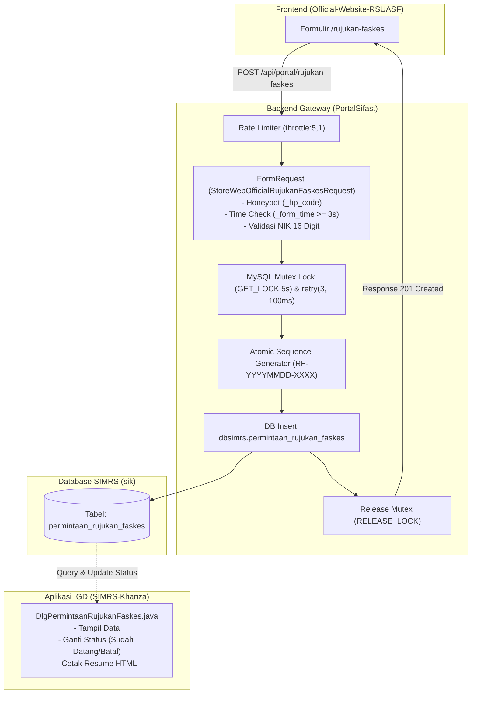

# Dokumentasi Teknis Backend API: Modul Permintaan Rujukan Masuk FASKES

Dokumen ini merupakan panduan teknis dan spesifikasi arsitektur resmi untuk implementasi **Fitur Permintaan Rujukan Masuk FASKES** pada backend **PortalSifast**. Modul ini bertindak sebagai gerbang terverifikasi (*secure verified gateway*) yang menjembatani formulir publik website resmi rumah sakit dengan basis data operasional Sistem Informasi Manajemen Rumah Sakit (**SIMRS Khanza**).

---

## 1. Peran & Posisi Arsitektur PortalSifast

Dalam ekosistem integrasi tiga aplikasi:
1. **Frontend Web Publik** (`Official-Website-RSUASF`): Antarmuka pengisian data rujukan oleh dokter/perawat FKTP (Puskesmas/Klinik).
2. **Backend REST API** (`PortalSifast`): Validasi keamanan, proteksi anti-spam/flood, penomoran atomik anti-race-condition, dan persistensi data transaksi.
3. **Desktop IGD & Rekam Medis** (`SIMRS-Khanza`): Aplikasi Java Swing untuk pemantauan rujukan masuk real-time, triase, pembaruan status kedatangan pasien, dan cetak resume medis.



---

## 2. Skema Basis Data & Konfigurasi Multi-Koneksi

Modul ini **tidak menyimpan data rujukan pada tabel internal PortalSifast**, melainkan langsung menulis ke database utama SIMRS Khanza (`sik`) menggunakan koneksi **`dbsimrs`**.

### 2.1 Konfigurasi Database (`config/database.php`)
Pastikan koneksi `dbsimrs` terkonfigurasi dengan benar di environment (`.env`). PortalSifast menggunakan konvensi penamaan environment dengan akhiran `_2` untuk database sekunder SIMRS Khanza:
```env
# Koneksi Database SIMRS Khanza (dbsimrs) pada .env
DB_HOST_2=127.0.0.1
DB_PORT_2=3306
DB_DATABASE_2=sik
DB_USERNAME_2=root
DB_PASSWORD_2=...
```

> [!IMPORTANT]
> **Source of Truth Multi-Koneksi**: Pada berkas `config/database.php`, koneksi `dbsimrs` merujuk langsung ke variabel `DB_HOST_2`, `DB_PORT_2`, `DB_DATABASE_2`, `DB_USERNAME_2`, dan `DB_PASSWORD_2`. Jangan menggunakan prefix `DBSIMRS_*` karena tidak terbaca oleh file konfigurasi framework Laravel pada repositori ini.

### 2.2 Berkas Migrasi Database
- Lokasi: `database/migrations/2026_11_04_000001_create_permintaan_rujukan_faskes_table.php`
- Koneksi: `protected $connection = 'dbsimrs';`
- Skema Kolom:

| Kolom | Tipe Data | Nullable | Keterangan |
|---|---|---|---|
| `no_rujukan` | `varchar(20)` | No (PK) | Nomor unik rujukan: `RF-YYYYMMDD-XXXX` |
| `tanggal_rujukan` | `date` | No | Tanggal masuk rujukan (`YYYY-MM-DD`) |
| `jam_rujukan` | `time` | No | Waktu masuk rujukan (`HH:MM:SS`) |
| `nama_fktp` | `varchar(100)` | No | Nama instansi FKTP / Puskesmas / Klinik |
| `nama_perujuk` | `varchar(60)` | No | Nama dokter/bidan/perawat perujuk |
| `no_telp_perujuk` | `varchar(20)` | No | Nomor kontak WhatsApp/telepon perujuk |
| `nama_pasien` | `varchar(100)` | No | Nama lengkap pasien |
| `no_ktp` | `varchar(20)` | No | NIK (Nomor Induk Kependudukan) 16 digit |
| `jk` | `enum('L','P')` | No | Jenis kelamin pasien |
| `tgl_lahir` | `date` | Yes | Tanggal lahir pasien jika diketahui |
| `umur` | `varchar(15)` | Yes | Teks umur (contoh: `35 Th`, `6 Bl`) |
| `no_telp_pasien` | `varchar(20)` | Yes | Kontak keluarga / pasien |
| `diagnosa` | `text` | No | Diagnosa kerja/awal dokter FKTP |
| `keluhan_utama` | `text` | Yes | Ringkasan keluhan dan riwayat sakit |
| `tanda_vital_kesadaran` | `varchar(30)` | Yes | Tingkat kesadaran (Compos Mentis / dll) |
| `tanda_vital_td` | `varchar(15)` | Yes | Tekanan darah (contoh: `120/80`) |
| `tanda_vital_nadi` | `varchar(10)` | Yes | Denyut nadi (x/menit) |
| `tanda_vital_rr` | `varchar(10)` | Yes | Frekuensi napas (x/menit) |
| `tanda_vital_suhu` | `varchar(10)` | Yes | Suhu tubuh (°C) |
| `tanda_vital_spo2` | `varchar(10)` | Yes | Saturasi oksigen (%) |
| `tindakan_diberikan` | `text` | Yes | Terapi, infus, oksigen yang sudah diberikan |
| `transportasi` | `varchar(50)` | Yes | Ambulans FKTP, mobil pribadi, dll |
| `kebutuhan_khusus` | `varchar(100)` | Yes | Fasilitas prioritas (Resusitasi, O2, Isolasi) |
| `estimasi_tiba` | `varchar(50)` | Yes | Perkiraan tiba (contoh: `15 menit`, `18:30`) |
| `status` | `enum(...)` | No | `Menunggu` (default), `Sudah Datang`, `Batal` |
| `catatan_igd` | `text` | Yes | Catatan tindak lanjut petugas triase IGD |
| `ip_address` | `varchar(45)` | Yes | Alamat IP pengirim (audit trail) |
| `user_agent` | `text` | Yes | Info browser pengirim (audit trail) |
| `created_at` | `timestamp` | No | Timestamp dibuat (`CURRENT_TIMESTAMP`) |
| `updated_at` | `timestamp` | No | Timestamp update (`ON UPDATE CURRENT_TIMESTAMP`) |

### 2.3 Indeks Performa & Kompatibilitas Engine
Tabel menggunakan `InnoDB` dengan charset `latin1` dan collate `latin1_swedish_ci` agar sejalan dengan konvensi database SIMRS Khanza:
- `idx_tgl_status` (`tanggal_rujukan`, `status`): Mengoptimalkan pencarian harian dan filter antrean IGD.
- `idx_no_ktp` (`no_ktp`): Mempercepat pencarian riwayat medis pasien berdasar NIK.
- `idx_nama_pasien` (`nama_pasien`): Mempercepat pencarian instan nama pasien di aplikasi Khanza.

---

## 3. Routing & Kebijakan Rate Limiting

Pendaftaran rute API terletak di `routes/api.php`:

```php
// Route alias untuk kompatibilitas proxy Vite pengembangan
Route::post('rujukan-faskes', [WebOfficialRujukanFaskesController::class, 'store'])
    ->middleware('throttle:5,1');

Route::prefix('portal')->group(function () {
    Route::post('/rujukan-faskes', [WebOfficialRujukanFaskesController::class, 'store'])
        ->middleware('throttle:5,1');
});
```

### Kenapa Terdapat Rute Alias?
Pada lingkungan lokal development Vite (`Official-Website-RSUASF`), konfigurasi proxy memotong prefiks `/api/portal` sehingga request keluar menuju `/api/rujukan-faskes`. Sedangkan pada konfigurasi produksi statis, frontend langsung memanggil `/api/portal/rujukan-faskes`. Kedua rute diarahkan ke controller yang sama demi reliabilitas lingkungan dev maupun staging/prod.

### Rate Limiting (`throttle:5,1`) & Resolusi IP Klien
Untuk mencegah DoS/spam flood dari alamat IP yang sama, endpoint dibatasi maksimal **5 kali request per menit**. Request ke-6 dalam jendela 1 menit yang sama akan mengembalikan respon:
```json
HTTP/1.1 429 Too Many Requests
{
  "message": "Too Many Attempts."
}
```

> [!NOTE]
> **Resolusi IP di Belakang Reverse Proxy**: Karena endpoint ini bersifat publik (tanpa token login), rate limiter Laravel mengelompokkan request berdasarkan `$request->ip()`. PortalSifast telah mengaktifkan konfigurasi *Trust Proxies* (`App\Http\Middleware\TrustProxies` / `bootstrap/app.php`) agar alamat IP yang dievaluasi rate limiter dan dicatat ke kolom `ip_address` adalah IP asli perangkat perujuk (`X-Forwarded-For`), bukan IP perantara Nginx reverse proxy ataupun Cloudflare.

---

## 4. Mekanisme Keamanan Berlapis (Anti-Spam & Bot Shield)

Validasi input dikelola oleh FormRequest:
`App\Http\Requests\Api\WebOfficial\StoreWebOfficialRujukanFaskesRequest`

```php
public function rules(): array
{
    return [
        'nama_fktp' => ['required', 'string', 'max:100'],
        'nama_perujuk' => ['required', 'string', 'max:60'],
        'no_telp_perujuk' => ['required', 'string', 'regex:/^[\d+\-\s()]+$/', 'min:9', 'max:20'],
        'nama_pasien' => ['required', 'string', 'max:100'],
        'no_ktp' => ['required', 'digits:16'],
        'jk' => ['required', Rule::in(['L', 'P'])],
        'tgl_lahir' => ['nullable', 'date'],
        'umur' => ['nullable', 'string', 'max:15'],
        'no_telp_pasien' => ['nullable', 'string', 'max:20'],
        'diagnosa' => ['required', 'string', 'max:2000'],
        'keluhan_utama' => ['nullable', 'string', 'max:2000'],
        'tanda_vital_kesadaran' => ['nullable', 'string', 'max:30'],
        'tanda_vital_td' => ['nullable', 'string', 'max:15'],
        'tanda_vital_nadi' => ['nullable', 'string', 'max:10'],
        'tanda_vital_rr' => ['nullable', 'string', 'max:10'],
        'tanda_vital_suhu' => ['nullable', 'string', 'max:10'],
        'tanda_vital_spo2' => ['nullable', 'string', 'max:10'],
        'tindakan_diberikan' => ['nullable', 'string', 'max:2000'],
        'transportasi' => ['nullable', 'string', 'max:50'],
        'kebutuhan_khusus' => ['nullable', 'string', 'max:100'],
        'estimasi_tiba' => ['nullable', 'string', 'max:50'],
        '_hp_code' => ['prohibited', 'max:0'],
        '_form_time' => ['required', 'integer'],
    ];
}
```

### 4.1 Honeypot Trap (`_hp_code`)
- Input field `_hp_code` dirender secara tersembunyi (hidden/invisible) di browser manusia.
- Bot / web scraper otomatis yang mengisi setiap input field pada form HTML akan mengisi nilai ini.
- Aturan validasi `prohibited|max:0` mendeteksi keberadaan nilai tersebut dan langsung menolak request dengan HTTP 422 tanpa memproses data ke database.

### 4.2 Time-to-Submit Verification (`_form_time`)
- Saat formulir dimuat di browser perujuk, `_form_time` diset dengan timestamp detik saat itu (`Math.floor(Date.now() / 1000)`).
- Di sisi server, hook `withValidator` memeriksa selisih waktu:
  ```php
  $formTime = (int) $this->input('_form_time');
  if ((time() - $formTime) < 3) {
      $validator->errors()->add('_form_time', 'Pengiriman formulir terlalu cepat. Silakan tunggu beberapa detik.');
  }
  ```
- Bot yang mengirim form dalam waktu di bawah 3 detik akan otomatis ditolak.
- Logika `(time() - $formTime) < 3` sekaligus menangkal bot yang memalsukan timestamp di masa depan (*future timestamp/clock skew*), karena nilai negatif otomatis lebih kecil dari 3 dan langsung memicu penolakan.

### 4.3 Format JSON Error Terstandarisasi
Jika validasi gagal, method `failedValidation` melempar `HttpResponseException` dengan struktur konsisten:
```json
HTTP/1.1 422 Unprocessable Content
Content-Type: application/json

{
  "success": false,
  "message": "Validasi gagal.",
  "errors": {
    "no_ktp": ["Nomor KTP (NIK) harus terdiri dari 16 digit angka."]
  }
}
```

---

## 5. Mesin Penomoran Rujukan Atomik (Zero Collision Mutex)

### 5.1 Format Nomor Rujukan
Format nomor rujukan:
$$\text{RF-YYYYMMDD-XXXX}$$
- `RF`: Kode prefiks Rujukan Faskes
- `YYYYMMDD`: Tanggal masuk sistem (contoh: `20261104`)
- `XXXX`: Nomor urut sekuensial harian 4 digit dengan padding nol (`0001`, `0002`, dst). Urutan otomatis reset ke `0001` setiap pergantian hari.

### 5.2 Penanganan Konkurensi & Mutex Database
Jika beberapa perujuk mengirimkan data di milidetik yang sama, pendekatan `COUNT(*)` atau `SELECT MAX` biasa rentan terhadap **kondisi balapan (race condition)** yang menyebabkan error `Duplicate entry 'RF-...' for key 'PRIMARY'`.

Solusi yang diimplementasikan di `WebOfficialRujukanFaskesController.php`:
1. **Named Lock MySQL (`GET_LOCK`)**:
   Meminta mutex lock setingkat database berdasar tanggal:
   ```sql
   SELECT GET_LOCK('lock_rujukan_faskes_2026-11-04', 5) as acquired;
   ```
   Server menunggu hingga 5 detik untuk memperoleh kunci eksklusif sebelum menghitung sequence.
2. **Kueri Urutan Terakhir**:
   ```php
   $latest = DB::connection('dbsimrs')
       ->table('permintaan_rujukan_faskes')
       ->where('no_rujukan', 'like', $prefix.'%')
       ->orderByDesc('no_rujukan')
       ->value('no_rujukan');
   ```
3. **Penyisipan Data & Pelepasan Lock**:
   Setelah baris data berhasil di-insert, lock **wajib dilepas** di dalam blok `finally`:
   ```php
   } finally {
       if ($isMysql && $lockAcquired) {
           DB::connection('dbsimrs')->select('SELECT RELEASE_LOCK(?)', [$lockName]);
       }
   }
   ```
4. **Resilience Retry Wrapper**:
   Seluruh blok dibungkus fungsi `retry(3, callback, 100)`. Jika terjadi deadlock atau timeout lock sesaat, sistem otomatis mengulang hingga 3 kali dengan jeda 100ms sebelum mengembalikan error.

---

## 6. Spesifikasi Kontrak Request & Response

### 6.1 Endpoint
`POST /api/portal/rujukan-faskes` atau `POST /api/rujukan-faskes`

### 6.2 Contoh Request Body
```json
{
  "nama_fktp": "Puskesmas Tulangan",
  "nama_perujuk": "dr. Ahmad Santoso",
  "no_telp_perujuk": "081234567890",
  "nama_pasien": "Tn. Budi Utomo",
  "no_ktp": "3515081205850002",
  "jk": "L",
  "tgl_lahir": "1985-05-12",
  "umur": "39 Th",
  "no_telp_pasien": "089876543210",
  "diagnosa": "Acute Coronary Syndrome suspect STEMI Anteroseptal",
  "keluhan_utama": "Nyeri dada khas menjalar ke lengan kiri sejak 1 jam SMRS",
  "tanda_vital_kesadaran": "Compos Mentis",
  "tanda_vital_td": "150/90",
  "tanda_vital_nadi": "96",
  "tanda_vital_rr": "22",
  "tanda_vital_suhu": "36.7",
  "tanda_vital_spo2": "95",
  "tindakan_diberikan": "O2 Nasal Kanul 3 lpm, Aspilet 160mg chewable, ISDN 5mg sublingual",
  "transportasi": "Ambulans FKTP",
  "kebutuhan_khusus": "Bed Resusitasi Jantung & EKG Standby",
  "estimasi_tiba": "15 Menit",
  "_hp_code": "",
  "_form_time": 1730700000
}
```

### 6.3 Contoh Response Sukses (HTTP 201 Created)
```json
{
  "success": true,
  "message": "Permintaan rujukan berhasil dicatat.",
  "data": {
    "no_rujukan": "RF-20261104-0001",
    "tanggal_rujukan": "2026-11-04",
    "jam_rujukan": "13:20:15",
    "nama_pasien": "Tn. Budi Utomo",
    "nama_fktp": "Puskesmas Tulangan"
  }
}
```

### 6.4 Contoh Response Error Server (HTTP 500)
Jika koneksi database `dbsimrs` down atau timeout:
```json
{
  "success": false,
  "message": "Terjadi kesalahan pada sistem saat mencatat permintaan rujukan."
}
```
*Catatan:* Rincian exception lengkap otomatis dicatat ke `storage/logs/laravel.log` dengan tag `'Gagal mencatat permintaan rujukan faskes: ...'`.

---

## 7. Rangkaian Pengujian Otomatis (Automated Testing)

Repository dilengkapi dengan suite pengujian integrasi berbasis PHPUnit / Pest pada direktori `tests/Feature/Api/WebOfficial/`:

### 7.1 Berkas Pengujian
1. **`PermintaanRujukanDatabaseTest.php`**:
   - `test_permintaan_rujukan_faskes_table_exists`: Menguji keberadaan tabel pada koneksi `dbsimrs`.
   - `test_permintaan_rujukan_faskes_indexes_exist`: Menguji keberadaan kolom-kolom inti.
2. **`WebOfficialRujukanFaskesApiTest.php`**:
   - `test_can_submit_valid_rujukan_and_generates_atomic_no_rujukan`: Menguji payload valid, verifikasi status HTTP 201, kecocokan pola nomor `RF-YYYYMMDD-XXXX`, dan data tersimpan di DB.
   - `test_honeypot_submission_is_rejected`: Memastikan kiriman dengan `_hp_code` terisi ditolak (HTTP 422).
   - `test_invalid_nik_is_rejected`: Memastikan NIK selain 16 digit angka ditolak (HTTP 422).
   - `test_race_condition_concurrent_numbering_produces_distinct_numbers`: Menguji pembuatan sequence nomor yang berurutan tanpa collision.

### 7.2 Menjalankan Pengujian
Eksekusi pengujian dari root folder `PortalSifast`:
```bash
php artisan test tests/Feature/Api/WebOfficial/PermintaanRujukanDatabaseTest.php
php artisan test tests/Feature/Api/WebOfficial/WebOfficialRujukanFaskesApiTest.php
```

Hasil verifikasi:
```text
PASS  Tests\Feature\Api\WebOfficial\PermintaanRujukanDatabaseTest
✓ permintaan rujukan faskes table exists
✓ permintaan rujukan faskes indexes exist

PASS  Tests\Feature\Api\WebOfficial\WebOfficialRujukanFaskesApiTest
✓ can submit valid rujukan and generates atomic no rujukan
✓ honeypot submission is rejected
✓ invalid nik is rejected
✓ race condition concurrent numbering produces distinct numbers

Tests:    6 passed (34 assertions)
```

---

## 8. Keterkaitan Lintas Aplikasi & Catatan Pemeliharaan

1. **Sinkronisasi dengan `Official-Website-RSUASF`**:
   - Skema validasi backend `StoreWebOfficialRujukanFaskesRequest` harus selalu sejalan dengan skema frontend `rujukanFaskesSchema` di `rujukan-faskes-form.tsx`. Khususnya panjang karakter field:
     - `nama_fktp`: max 100
     - `nama_perujuk`: max 60
     - `nama_pasien`: max 100
     - `no_ktp`: tepat 16 digit
     - `diagnosa`: max 2000
2. **Sinkronisasi dengan `SIMRS-Khanza`**:
   - Status awal data rujukan yang di-insert oleh API selalu berstatus `'Menunggu'`.
   - Modul desktop `DlgPermintaanRujukanFaskes.java` di IGD membaca langsung baris data ini tanpa memerlukan polling API tambahan karena berada pada database fisik yang sama (`sik`).
   - Saat petugas IGD mengubah status menjadi `'Sudah Datang'` atau `'Batal'` via desktop Khanza, perubahan langsung tersimpan di tabel `permintaan_rujukan_faskes`.
3. **Audit Trail**:
   - Setiap transaksi mencatat `ip_address` dan `user_agent` pengirim guna mempermudah investigasi tim IT jika terjadi indikasi penyalahgunaan formulir rujukan darurat.
